<div align="center">

  <h1>fts-design-system</h1>
  <p>从悬浮中转站提取并通用化的 UI/动效/前端设计体系：语义 token、动效档位、组件范式与跨平台适配——任何新软件或网站项目可直接套用。</p>

  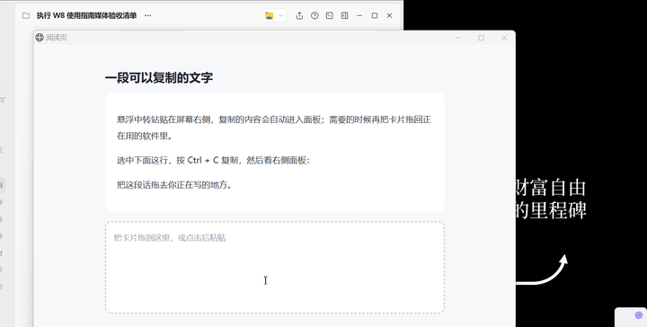
  <p><em>主循环演示：网页选段复制 → 入库 → 悬停展开 → 拖卡片回投放框（源应用「悬浮中转站」实拍，左下角角标为手势提示）</em></p>

  <p>
    <a href="https://github.com/Oiawlm/fts-design-system/releases"></a>
  </p>
  <p>
    <a href="platforms/"></a>
    <a href="LICENSE"></a>
  </p>

</div>

> [!NOTE]
> 这是一个设计体系资产仓：拿走的是 token 快照、平台镜像与文档，而不是可运行的应用。想看体系的完整实拍，去源项目 [floating-transfer-station](https://github.com/Oiawlm/floating-transfer-station)。

## 目录

- [特性](#-特性)
- [核心概念速览](#-核心概念速览)
- [30 秒快速开始](#-30-秒快速开始)
- [目录导览](#-目录导览)
- [界面一览](#-界面一览)
- [与源项目的关系](#-与源项目的关系)
- [当前限制](#-当前限制)
- [本地开发](#-本地开发)
- [参与贡献](#-参与贡献)
- [许可证](#-许可证)

## ✨ 特性

- **实战提取，不是纸面规范**：整套体系从 Windows 桌面应用「悬浮中转站」v1.72.0 基线全量提取，每个数值都能沿对账文档回溯到源码 commit `bba9b4e`。
- **镜像锁定测试的治理史**：源项目以五面自动化测试（画刷/圆角/边距/时长/字体）断言「界面层镜像 == 数值源」，一致性由构造保证，而非评审纪律。
- **W3C DTCG 标准 token**：颜色、尺寸、动效、排版四件 `.tokens.json`，色值只在语义层出口，机器可读可投影。
- **双平台即取镜像**：Web 侧 `tokens.css`（106 个 CSS 变量，内置深色与 `prefers-color-scheme` 跟随）；WPF 侧浅/深两本 `ResourceDictionary`（各 39 键）。
- **三方对账互锁**：`scripts/validate-tokens.ps1` 对 DTCG、CSS、XAML 三方校验，改源不重新投影即转红。
- **原则可自查**：六条设计原则各带落地判据与反例信号，全部不绑定任何框架。
- **AI Skill 投影**：同一体系封装为 ZCode skill（`skill/fts-style-system/`），AI 辅助开发时直接调用。

## 🧭 核心概念速览

**四层架构**——数值只有一处权威，其余全部是它的投影：

| 层 | 目录 | 角色 |
|---|---|---|
| 数值 | [`tokens/`](tokens/) | W3C DTCG 四件快照，全系统唯一数值权威 |
| 平台 | [`platforms/`](platforms/) | Web CSS 变量＋WPF 双主题字典，即取即用的镜像出口 |
| 叙述 | [`docs/`](docs/) | 25 篇正文：哲学/基础/范式/适配，人类可读的规则与判据 |
| 投影 | [`skill/`](skill/) | ZCode Skill，把体系带进 AI 辅助开发 |

**哲学六条**（一行版，展开见 [docs/philosophy.md](docs/philosophy.md)）：

| # | 原则 | 一句话 |
|---|---|---|
| 一 | 单一数值源＋镜像锁定 | 一切数值只在一处声明，自动化测试锁定「镜像 == 源」 |
| 二 | 恒定几何 | 无关状态不移动无关内容；一次状态迁移一次矩形变更 |
| 三 | 档位制而非连续值 | 圆角/时长/字号各收敛为极少数档位，新场景查表锚定 |
| 四 | 缓动按语义＋减动效退化 | 进入减速、离开加速；减动效下信息仍完整可感知 |
| 五 | 分层叠加状态＋悬停双轨 | 状态用独立图层交叉淡入；悬停按控件类型学分轨 |
| 六 | 克制与真实可达＋意图事务 | 动效可中断、不挡命中；不可用入口可点击并告知原因 |

## 🚀 30 秒快速开始

两条最短路径：拿一份平台镜像，按语义名消费。

**Web（CSS 变量）**

1. 把 [`platforms/web/tokens.css`](platforms/web/tokens.css) 复制进项目并引入：

   ```html
   <link rel="stylesheet" href="tokens.css">
   ```

2. 按语义名消费（与设计数值同名的 CSS 变量）：

   ```css
   .card {
     background: var(--color-surface-card);
     border-radius: var(--dimension-radius-control);
     transition-duration: var(--motion-duration-fast);
   }
   ```

深色主题：在 `<html>` 上设置 `data-theme="dark"` 手动切换，或依赖文件内置的 `prefers-color-scheme` 自动跟随系统。

**WPF（主题字典）**

1. 把 [`platforms/wpf/`](platforms/wpf/) 的两本字典复制进项目（如 `Themes/` 目录）。
2. 按当前主题合并其中一本到窗口（或 App）资源：

   ```xml
   <ResourceDictionary.MergedDictionaries>
     <ResourceDictionary Source="pack://application:,,,/YourAssembly;component/Themes/DesignTheme.Light.xaml" />
   </ResourceDictionary.MergedDictionaries>
   ```

3. 引用一律 `DynamicResource`：

   ```xml
   <Border Background="{DynamicResource CardBrush}"
           CornerRadius="{DynamicResource CardCornerRadius}">
   </Border>
   ```

运行时整本替换字典（同键位两套值）即全窗换肤，全部 `DynamicResource` 消费者即时生效。

## 📖 目录导览

完整路由（12 条「我想做 X → 读哪篇」）见 [docs/README.md](docs/README.md)，摘要如下：

| 我想… | 去哪 |
|---|---|
| 整体了解这套体系 | [docs/philosophy.md](docs/philosophy.md)，再读 [anti-patterns.md](docs/anti-patterns.md) |
| 查一个 token 的数值 | [`tokens/*.tokens.json`](tokens/)（权威），消费看 [`platforms/`](platforms/) |
| 做动效、定交互状态 | [docs/motion.md](docs/motion.md)、[docs/interaction-states.md](docs/interaction-states.md) |
| 选组件范式 | [docs/patterns/](docs/patterns/)：卡片、瓦片、网格、滚动条、对话框、空状态、chip 轨、贴边停靠、容器变换等 12 篇 |
| 新项目整体套用 | [docs/adaptation/adoption-workflow.md](docs/adaptation/adoption-workflow.md)（八步工作流＋最小采用集） |
| WPF / Web 落地细节 | [docs/adaptation/wpf.md](docs/adaptation/wpf.md)、[docs/adaptation/web.md](docs/adaptation/web.md) |

## 🖼️ 界面一览

以下资产全部实拍自源应用，逐张内容说明与再生方式见 [assets/README.md](assets/README.md)。

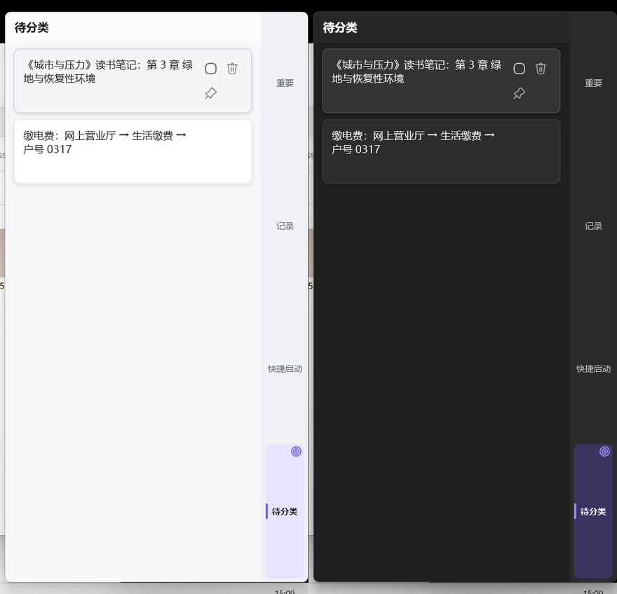

*同一展开面板的浅/深双主题对照（悬停操作钮在两主题下均可见）*


*悬停卡片浮现右上操作列（选择圈＋删除＋置顶），深色主题见 [card-ai-organize-dark.png](assets/card-ai-organize-dark.png)*


*设置窗双栏 IA：左导航激活态＋右侧分组卡片（主题/字体/动效开关等）*

<details>
<summary>完整图集（11 项：图解、静帧与动图；深色变体经正文图注链接可达）</summary>

**结构图解**

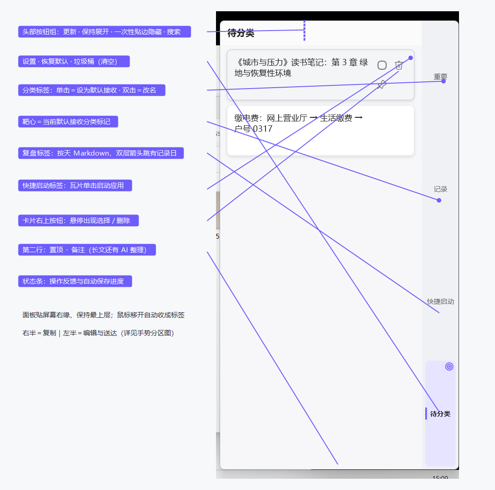

*面板展开态结构标注：头部按钮组/分类标签/卡片右上按钮/状态条*

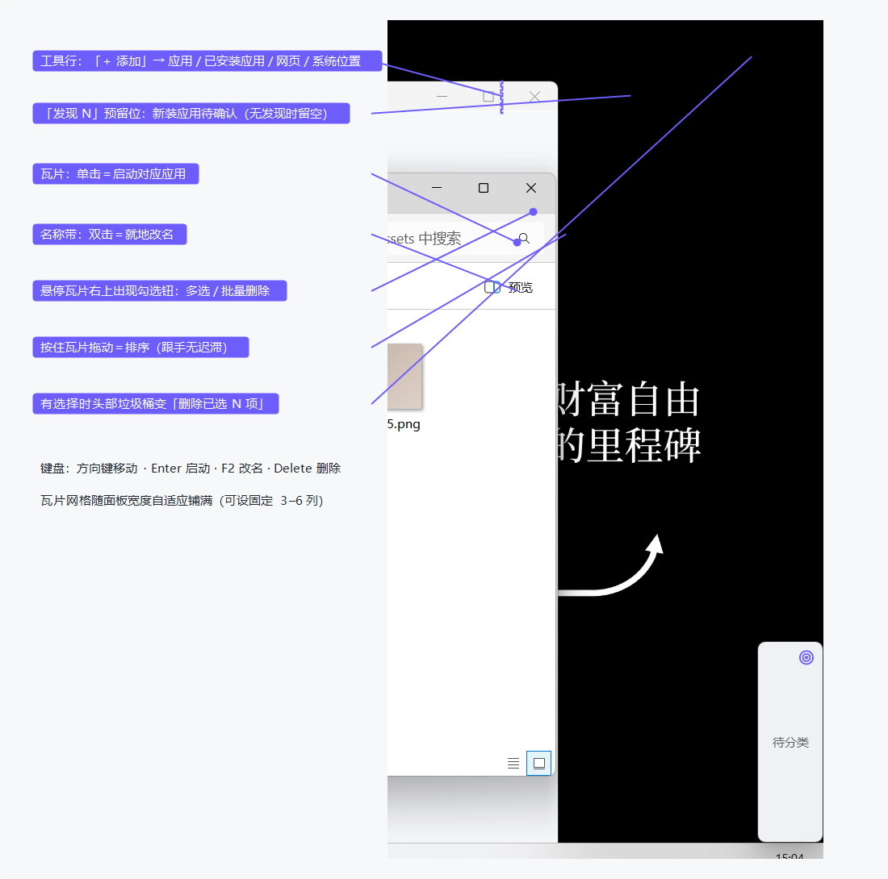

*启动页布局标注：工具行/瓦片/名称带/勾选钮/拖动排序*

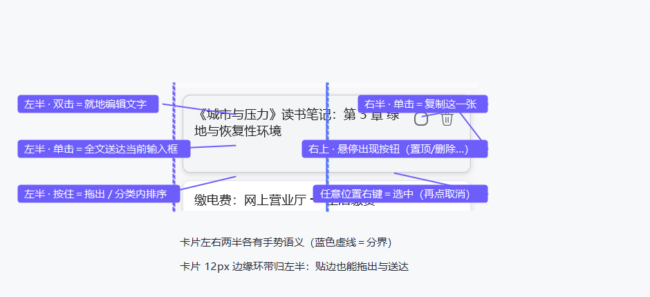

*卡片左右两半的手势分区（虚线分界）*

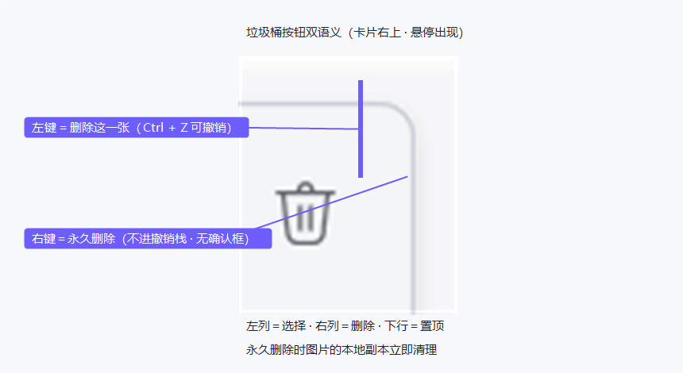

*删除钮双语义放大：左键可撤销、右键永久删除*

**静帧**


*置顶区与普通区之间的通栏强调色分隔线*

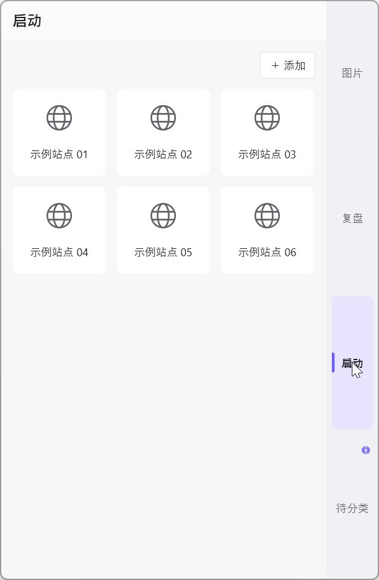

*启动瓦片面（浅色）：2×3 瓦片＋线框图标＋名称带，深色见 [quicklaunch-surface-dark.png](assets/quicklaunch-surface-dark.png)*

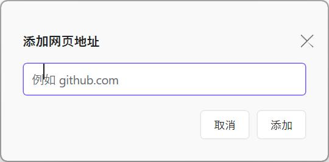

*添加网页地址对话框（浅色）：聚焦紫描边输入框＋双中性钮，深色见 [quicklaunch-url-dialog-dark.png](assets/quicklaunch-url-dialog-dark.png)*

**动图**

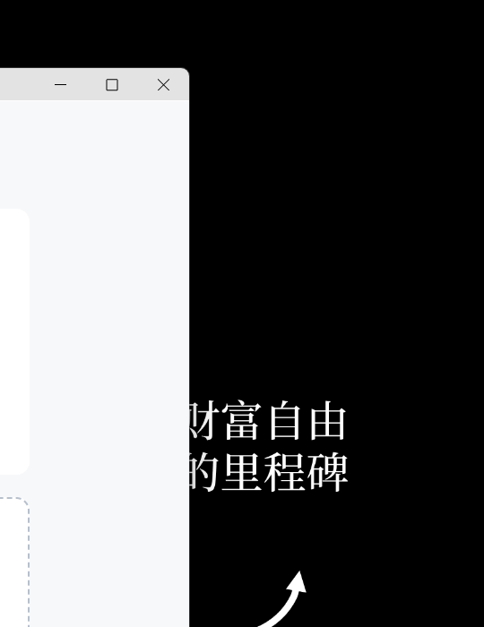

*分类内拖动重排：换位显示插入指示线，同位松手无指示线*

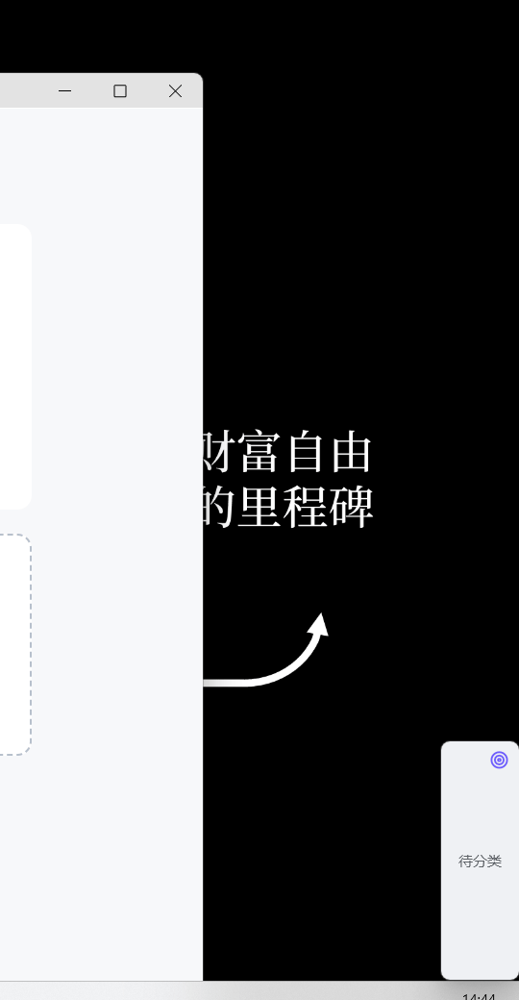

*右键多选三卡 → 头部图钉批量置顶 → 整批拖到目标分类*

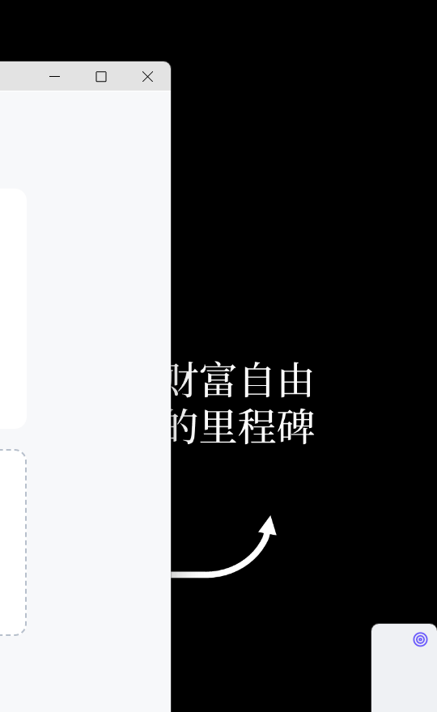

*归档视图「阅读/编辑」切换的 Markdown 渲染*


*移开收起 → 移入展开 → 保持展开开/关（自动收起原速基准）*

</details>

## 🔗 与源项目的关系

- **源项目**：[floating-transfer-station](https://github.com/Oiawlm/floating-transfer-station)（「悬浮中转站」）——贴在 Windows/macOS 屏幕边缘的文字与图片中转站，本体系的活样例。
- **提取基线**：fts `bba9b4e`（version 1.72.0，2026-11-10）；逐层对账链见 [reference/extractions/2026-11-fts-v1.72.0.md](reference/extractions/2026-11-fts-v1.72.0.md)。
- **标签机制**：每轮提取在本仓打 `fts-v<X.Y.Z>` 对账标签锚定源版本（现有 `fts-v1.72.0`）；本仓自身版本独立演进（v0.1.0 起）。
- **再提取**：源项目大版本升级后按 [docs/extraction-protocol.md](docs/extraction-protocol.md) 执行新一轮提取。

## ⚠️ 当前限制

- 文档正文中的数值均为**示例值**，权威快照只在 [`tokens/*.tokens.json`](tokens/)（正文表格一律「示例值｜token 路径」双列）。
- 视觉资产全部来自源应用（WPF 观感），Web 侧暂无截图——引入 `tokens.css` 即可自行验证观感。
- tokens↔平台镜像的一致性对账为本地脚本（`scripts/validate-tokens.ps1`），尚未接入 CI。

## 🛠️ 本地开发

无需构建——文档、token 与镜像即产物。克隆后跑一次对账脚本确认三方一致：

```bash
git clone https://github.com/Oiawlm/fts-design-system.git
cd fts-design-system
pwsh scripts/validate-tokens.ps1
```

最后一条命令对 DTCG、CSS、XAML 三方对账，全部一致时以 PASS 与退出码 0 结束。

## 🤝 参与贡献

数值疑问、范式补充与 WPF/Web 适配经验欢迎开 [Issue](https://github.com/Oiawlm/fts-design-system/issues) 讨论。改动纪律：数值先改 `tokens/`，再重新投影平台镜像，对账脚本不过禁止提交。

## 📄 许可证

[MIT](LICENSE)。本体系与视觉资产提取自源项目 [floating-transfer-station](https://github.com/Oiawlm/floating-transfer-station)（同为 MIT）。
